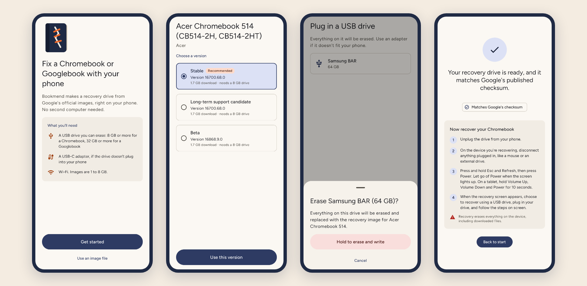
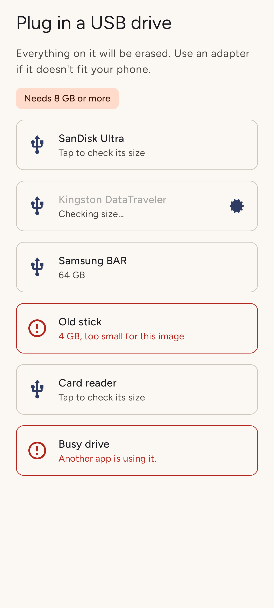
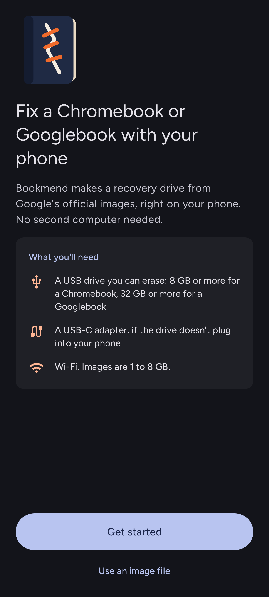
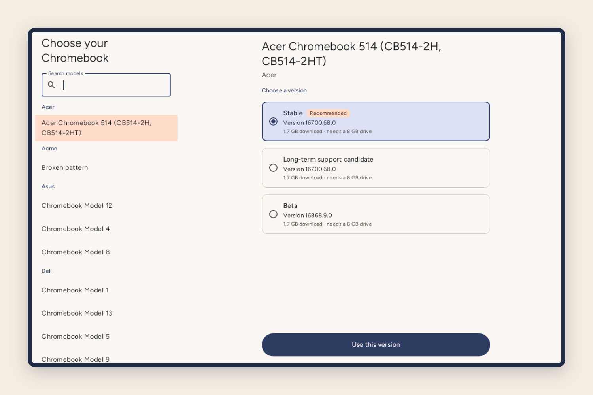

<p align="center">
  
</p>

<h1 align="center">Bookmend</h1>

<p align="center"><b>A recovery drive from your phone.</b></p>

<p align="center">
  Bookmend makes a USB recovery drive for a Chromebook or Googlebook, using Google's official images, on an Android phone. No second computer needed.
</p>

<p align="center">
  <a href="../../releases/latest"><b>Download the latest release</b></a>
  &nbsp;·&nbsp; <a href="#install">Install</a>
  &nbsp;·&nbsp; <a href="#how-its-built">How it's built</a>
</p>

<p align="center"><sub>Android 8.0 and later · phones, tablets and Googlebooks · talks only to Google's download server · Apache-2.0</sub></p>

<p align="center">
  
</p>

## What it does

When a Chromebook or Googlebook can't start, Google's fix is to make a recovery drive on another computer with Chrome. If the broken laptop was your only computer, that's where it stops. Bookmend does the same job from your phone: it downloads the official image for your exact model and writes it straight to a USB drive plugged into the phone.

- **Finds your model.** Type the model name from a Chromebook's recovery screen, or browse every Chromebook and Googlebook in Google's catalogs by manufacturer.
- **Checks the drive before it erases anything.** Only USB storage is listed. Each drive shows its size, a drive too small for the image is stopped before anything is downloaded, and erasing takes a deliberate press and hold.
- **Proves the result.** The download is checked against the checksum Google publishes, and every byte written is read back from the drive and compared.
- **Survives a shaky connection.** If Wi-Fi drops partway through a 7.7 GB Googlebook image, Bookmend picks up from the byte where it stopped.
- **Tells you what's next.** The finished screen shows the recovery steps for your device, with the right keys for a Chromebook or a Googlebook.
- **Carries your choice across devices.** On Android 17, Continue On lets you pick the model on your phone and finish on a Googlebook. It is switched off while a drive is being written, since that drive is in the phone.

Bookmend can only make drives for models in Google's public recovery catalogs. A Googlebook that isn't in the catalog yet can't be recovered this way, by Bookmend or by Google's own tool.

## A look around

<table>
  <tr>
    <td width="50%"></td>
    <td width="50%"></td>
  </tr>
  <tr>
    <td>Every drive says what it is. Too small or busy shows in red, with the reason.</td>
    <td>Light and dark follow the system. Colors follow your wallpaper on Android 12 and later.</td>
  </tr>
</table>



On a Googlebook, tablet or unfolded phone, the model list and its versions sit side by side. On a phone they are two steps with back between them.

## Your data

Bookmend talks to one server: `dl.google.com`, for Google's three public recovery catalogs and the image you choose. It has no accounts, analytics or ads, and it sends nothing about you or your devices anywhere. A local image file you pick stays on your phone. Continue On hands your model choice to your own Googlebook through Android, not through any server of ours.

## Install

- **From GitHub:** download the APK from the [latest release](../../releases/latest). It needs Android 8.0 or later and a phone that supports USB drives (USB OTG). The SHA-256 of the signing certificate is listed with each release so you can check it.
- **From Google Play:** not planned for now.

You'll also want a USB drive you can erase: 8 GB or more for a Chromebook, 32 GB or more for a Googlebook. Use an adapter if it doesn't fit your phone's port.

## How it's built

Bookmend is a single Jetpack Compose app in Kotlin. Its work happens in four layers, and each can be tested without the one below it.

**Catalogs.** `RecoveryRepository` reads Google's public catalogs: ChromeOS (`recovery2.json`), ChromeOS Flex, and the Googlebook catalog that Google's Device Recovery Utility uses. Chromebook entries carry a SHA-1 of the download and a hardware-ID pattern. Googlebook entries carry an MD5 of the download and are browsed by name.

**The flash.** Android doesn't give apps block access to a USB drive, so Bookmend speaks the USB Mass Storage protocol itself: SCSI `READ CAPACITY`, `WRITE(10)` and `READ(10)` over the drive's two bulk endpoints, with no root. `FlashEngine` streams the download through a digest and an unzip straight onto the drive in whole sectors. Nothing is stored on the phone, so a 19 GB Googlebook image needs no free space. It reads the drive's size first, so a drive that is too small fails at once rather than 16 GB in. When the write ends, it finishes the download's checksum and reads every sector back. `ResumableHttpStream` resumes a dropped download with an HTTP `Range` request, guarded by `If-Range` so a file that changed on the server is refused rather than spliced in.

**The wizard.** One `WizardViewModel` holds the choices in `SavedStateHandle`, so rotation, resizing and process death keep them. That is also what Continue On sends to another device. The model browser is a Material 3 adaptive list-detail layout, and the rest follows Material 3 Expressive: springy motion, the wavy progress bar, a step indicator and predictive back.

**Testing.**
- **150 JVM tests.** The core is a simulated USB drive that parses the real SCSI command blocks, so the full flash runs in tests: download, unzip, write, checksum and read-back. The simulated drive can fail writes, corrupt reads, return partial transfers and run out of space. Every screen is also tested with Compose UI tests under Robolectric.
- **96.5% line coverage, gated at 95% in CI.** The only code left out is marked `@CoverageExempt` with its reason:
  - `UsbBulkTransport` and `UsbDriveConnector`: the last thin layer over a physical USB device.
  - `DriveScreen`: the wrapper that listens for USB plug-in and permission broadcasts. The interface inside it, `DrivePicker`, is fully tested.
  - Two `MainActivity` calls: the Android 17 handoff API, which Robolectric doesn't model yet.
- **31 tests on an Android emulator:**
  - Google's Accessibility Test Framework over every main screen, in light, dark and at 200% font. A deliberately bad button proves the checks are live.
  - The Googlebook image's zip layout (sizes stored after the data, past 4 GiB) read with Android's own zip code, on Android 14 and Android 17.

The screenshots in this README come from those tests, rendered in the app's own colors. Not yet verified on hardware: a full flash and recovery on a physical drive and laptop for each family.

## Build it yourself

You need JDK 21 and the Android SDK with platform 37.

```bash
cd android
./gradlew assembleDebug                         # app/build/outputs/apk/debug/app-debug.apk
./gradlew testDebugUnitTest koverVerifyDebug    # JVM tests and the coverage gate
./gradlew connectedDebugAndroidTest             # emulator tests (one device attached)
```

Screenshots render to `android/app/build/outputs/roborazzi/` during the unit tests. Release builds are shrunk with R8. Release signing reads `~/.config/bookmend/keystore.properties` (`storeFile`, `storePassword`, `keyAlias`, `keyPassword`), which never enters the repository. Without it, release builds are unsigned, and debug builds work for anyone.

## Licenses

Bookmend is licensed under the [Apache License 2.0](LICENSE). The [NOTICE](NOTICE) file reads, in part: "Bookmend began as Book Recovery Utility by Alexander (https://github.com/kuscher), used and relicensed here with his permission."

The app is built on Android Jetpack, Kotlin and Gson (Apache-2.0), and sets its text in Figtree (SIL Open Font License 1.1). The waiting game uses Chromium's T-Rex sprites (BSD 3-Clause). Every notice is in the app under More options > Open-source licenses.

## About

> Bookmend is a personal project by Jesse Johnston ([jessejohnston.ai](https://jessejohnston.ai)).
> It is not affiliated with or endorsed by Google or any employer. It began as
> [Book Recovery Utility](https://github.com/kuscher) by Alexander, who wrote its
> first USB flasher, and it is shared here with his permission.
>
> Copyright 2026 Jesse Johnston. Licensed under the Apache License 2.0.
